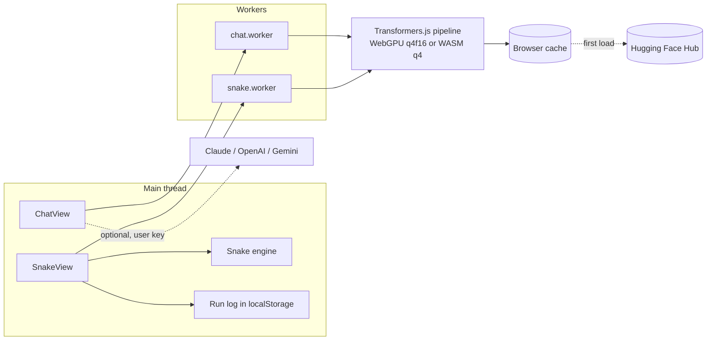

# Offline-AI

Small language models running in your browser. Watch them play Snake while
latency and tokens per second are measured live, or chat with them. After the
first download, offline mode makes no network requests.

Live demo: https://pixytech.github.io/Offline-AI/

Part of the Pixytech app family, listed at https://portal.pixytech.com

## Features

- **Snake benchmark.** On every move the loaded model is given the board as a
  short text prompt and must answer with one direction word. Decision latency
  and tokens per second are timed per move. Finished runs are logged per model
  and device so models can be compared side by side.
- **Safety shield.** A move is overridden only when it would immediately hit a
  wall or the snake's own body. Each override is counted as "Corrected /
  shielded" so speed and survival stay comparable across very different model
  sizes.
- **Chat.** Multi-turn chat with the same offline models, with a system prompt,
  context meter and stop button. Optionally switch the source to Claude,
  OpenAI or Gemini using your own key.
- **Model picker.** Ten models with size, speed and quality notes.
- **Pace control.** Run Snake at maximum speed or throttle to a target number
  of moves per second.

### Models

| Group | Models |
|---|---|
| General | SmolLM2 135M, 360M and 1.7B; Qwen 2.5 0.5B and 1.5B; Llama 3.2 1B; Phi 3.5 Mini |
| Code | Qwen2.5-Coder 0.5B, 1.5B and 3B |

Weights come from the Hugging Face Hub through Transformers.js and are
downloaded once per browser.

## Architecture

### Overview



### Components

- **App shell** (`src/App.tsx`): two views, Snake and Chat, selected by a tab
  bar. The last tab is remembered.
- **Snake engine** (`src/lib/snakeGame.ts`): pure game logic on a 14 by 14
  board with no model dependency. Builds the text description of the board and
  parses the model's reply into a direction.
- **Snake worker** (`src/snake/snake.worker.ts`): loads a model and answers
  `decide` requests. Generation is greedy and limited to 4 new tokens. A
  TextStreamer counts tokens so tokens per second can be reported.
- **Chat worker** (`src/chat/chat.worker.ts`): loads a model and streams a
  chat completion token by token.
- **Model registry** (`src/lib/offlineModels.ts`): the list of models with
  size, speed, context length and usage notes.
- **API streaming** (`src/lib/apiStream.ts`): streaming clients for the
  Claude, OpenAI and Gemini HTTP APIs, used only in Chat when the user picks
  one of those sources.
- **Run log**: per-run results are stored in localStorage (last 20 runs) and
  aggregated by model and device for the comparison table.

### Device selection

Each worker checks for WebGPU. If an adapter is available the model runs with
`q4f16` weights on the GPU, otherwise it falls back to WASM with `q4` weights.
Results are logged against the device because WebGPU and WASM numbers for the
same weights are not comparable.

### Flow of one Snake move

1. The engine describes the board: head position, current direction and where
   the food is relative to the head.
2. SnakeView posts a `decide` message with that prompt to the worker.
3. The worker applies the chat template, adds a one-shot example whose right
   answer differs from the current heading, and ends the prompt with an open
   `Direction:` cue so even very small models answer in the expected format.
4. The model generates up to 4 tokens. The worker returns the text, token
   count and elapsed time.
5. The parser extracts UP, DOWN, LEFT or RIGHT.
6. The shield replaces the move only if it would immediately cause a death,
   and increments the correction counter.
7. The engine applies the move and the stats panel is updated.

### Design decisions

- **Inference in workers.** Generation never blocks rendering, so the board
  and controls stay responsive at maximum pace.
- **A shield instead of trusting the model.** The smallest models fail at
  spatial reasoning very often. Without the shield runs end in a few moves and
  produce no useful timing data. Counting every override keeps the comparison
  honest.
- **Log by model and device.** Replaying a model averages its stats across
  runs rather than adding a row per attempt.
- **One-shot prompt.** In-context examples steer small instruct models more
  reliably than instructions alone.

### Privacy

- Offline models run entirely in the browser. After the weights are cached,
  Snake and offline Chat make no network requests.
- If you choose Claude, OpenAI or Gemini in Chat, your messages are sent from
  the browser straight to that provider. API keys are stored in localStorage on
  your device only. Gemini uses Google sign-in with a client id you supply.

### Limits

- First load of a model downloads between roughly 270 MB and 3.4 GB.
- WebGPU availability varies by browser and device. WASM is much slower.
- Small models are weak at multi-turn conversation and reasoning.
- Memory use grows with model size. Large models may not load on low-memory
  devices.

## Project layout

```
src/
  App.tsx                 shell and tab bar
  views/SnakeView.tsx     Snake UI, stats and comparison table
  views/ChatView.tsx      Chat UI, model and provider settings
  snake/snake.worker.ts   Snake inference worker
  chat/chat.worker.ts     Chat inference worker
  lib/snakeGame.ts        game engine
  lib/offlineModels.ts    model registry
  lib/apiStream.ts        optional cloud API clients
```

## Develop

```
npm install
npm run dev
npm run build
```

## Deploy

Pushing to `main` runs `.github/workflows/deploy.yml`, which builds the app and
publishes it to GitHub Pages. In the repository settings, set Pages source to
GitHub Actions. The Vite `base` in `vite.config.ts` must match the repository
name.

`portal.json` lets the Pixytech portal list this app.

## Licence

MIT. See LICENSE.
